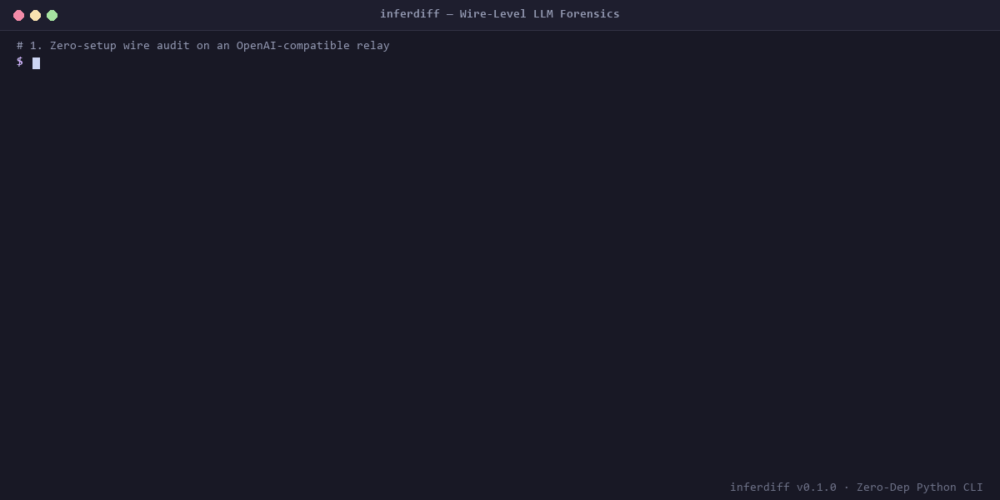
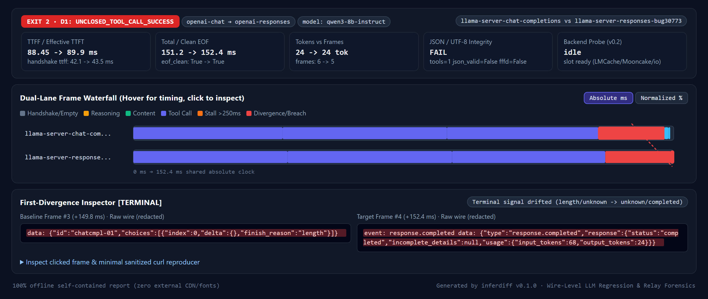

# inferdiff

[](https://github.com/ApacheWang/inferdiff/actions/workflows/ci.yml)
[](https://github.com/ApacheWang/inferdiff)
[](https://github.com/ApacheWang/inferdiff/blob/main/pyproject.toml)
[](https://github.com/ApacheWang/inferdiff/blob/main/LICENSE)

**Wireshark & protocol bill-checker for streaming LLM APIs.**

Catch silent `HTTP 200 OK` failures — truncated tool JSON, ghost thinking starvation, buffered nonconformant SSE relays, and illusory benchmark speedups — with **zero third-party runtime dependencies** (Python 3.10+ standard library only).

[中文文档 (README.zh-CN.md)](https://github.com/ApacheWang/inferdiff/blob/main/README.zh-CN.md) · [PyPI (`inferdiff`)](https://pypi.org/project/inferdiff/) · [Releases](https://github.com/ApacheWang/inferdiff/releases)

`v0.1.0` introduced OpenAI Chat and Responses canaries (`C1`–`C8`), trace recording, offline diffs, and HTML waterfalls. `v0.1.1` improved checks for thinking models and relays and added a GitHub Action. `v0.2.0` adds Anthropic and Gemini canaries, KV and storage probes, A/B canary comparison, continuous monitoring, and offline replay with CI reports. See the [changelog](CHANGELOG.md).

The v0.2 features below are unreleased. From a checkout of this branch, run `python -m pip install .` to use `0.2.0.dev0`.



## Why `inferdiff`? (`HTTP 200 OK` != Your Stream Worked)

Standard uptime monitors and latency benchmarks only check HTTP status codes and wall-clock speed. In production, streaming LLM upgrades and third-party OpenAI-compatible relays routinely return `200 OK` while silently corrupting wire contracts:

| Who Gets Burned | What Breaks Silently Under `HTTP 200 OK` | Real-World Bug Anchors | How `inferdiff` Catches It |
| :--- | :--- | :--- | :--- |
| **Agent & App Engineers** | Tool-call JSON arguments are cut off mid-string by token budgets yet reported as `completed` / `stop`, reasoning tokens starve `content` to empty, or chunk splits emit `U+FFFD` replacement chars — sending agents into retry loops. | [`llama.cpp #30773`](https://github.com/ggml-org/llama.cpp/issues/30773), [`Ollama #17274`](https://github.com/ollama/ollama/issues/17274), [`vLLM #68324`](https://github.com/vllm-project/vllm/issues/68324) | Rules `D1`, `D2` & Canary `C1`, `C2`, `C6` validate strict JSON syntax trees, UTF-8 multibyte boundaries, and terminal state honesty. |
| **API Relay & Gateway Users** | Proxies buffer upstream non-streaming responses and dump them as a fake SSE burst, strip trailing `include_usage` chunks, undercount tool-schema tokens, strip initial `delta.role`, or route across mixed-quantization pools. | [`LiteLLM #5803`](https://github.com/BerriAI/litellm/issues/5803), [`LiteLLM #16112`](https://github.com/BerriAI/litellm/issues/16112), [`LiteLLM #24221`](https://github.com/BerriAI/litellm/issues/24221), [vLLM Streaming Usage](https://docs.vllm.ai/en/latest/serving/online_serving/derenderer/) | `inferdiff doctor --profile relay` runs low-budget canary probes (`C1–C8`) and grades wire health from `A+` to `F`. |
| **AI Infra & Perf Engineers** | Engine upgrades report massive throughput/TTFT jumps because fixed-length `ignore_eos` runs stopped at `8 / 8000` tokens, prefix caches leaked across runs, or empty handshake frames gamed first-frame timers. | [`SGLang #53119`](https://github.com/sgl-project/sglang/pull/53119), [`SGLang #50443`](https://github.com/sgl-project/sglang/issues/50443), [vLLM Benchmarking CLI](https://docs.vllm.ai/en/stable/benchmarking/cli/) | Separates empty handshake `ttff_ms` from real `ttft_effective_ms` and flags short-generation & cache-pollution illusions (`D3`, `D5`). |
| **OSS Contributors & Release CI** | SSE chunk boundaries shift between runs, making raw `curl` logs impossible to diff by eye — while noisy log dumps get closed upstream. | [rusefi LLM Policy](https://github.com/rusefi/rusefi/wiki/LLM-policy) | Normalizes chunk jitter, pins the **exact first divergent wire frame**, and exports an airgapped `<80 KiB` HTML waterfall or a `<=25`-line redacted `curl` reproducer. |

## 5-Second Quickstart (Zero Install via `uvx` or `pip`)

Zero-install via [`uvx`](https://docs.astral.sh/uv/guides/tools/) directly from [PyPI](https://pypi.org/project/inferdiff/), or install locally with `pip` (Python 3.10+, zero third-party dependencies):

```bash
# 1. Zero-install live health check on a local engine (llama-server, vLLM, SGLang, Ollama)
uvx inferdiff doctor http://127.0.0.1:8080/v1 --html doctor.html

# 2. Audit an OpenAI-compatible relay API + generate shareable single-file HTML scorecard
OPENAI_API_KEY="$RELAY_API_KEY" uvx inferdiff doctor https://api.your-relay.example/v1 \
  --model qwen3-32b --profile relay --html relay-report.html

# 3. Or install once from PyPI
pip install inferdiff

# Offline demo on bundled Case 1 (llama.cpp #30773, clone repo — no GPU or server required)
inferdiff diff \
  examples/case1_responses_truncated_tool/baseline.trace.jsonl \
  examples/case1_responses_truncated_tool/target.trace.jsonl \
  --html case1-waterfall.html

inferdiff export \
  examples/case1_responses_truncated_tool/baseline.trace.jsonl \
  examples/case1_responses_truncated_tool/target.trace.jsonl \
  --format github-issue
```

> **Auth note**: If neither `--api-key` nor `-H "Authorization: ..."` is passed, `inferdiff doctor` falls back to `OPENAI_API_KEY` from the environment and sends it to the target URL (use `https://` for production keys). Reflected secrets are scrubbed from terminal output, saved traces, JSON, and HTML exports.

## Single-File Offline HTML Frame Waterfall

Every `diff --html`, `audit --html`, `doctor --html`, and `export --format html` command produces a self-contained, airgap-safe HTML5 + inline SVG report strictly under `80 KiB` with zero external CDN requests:



> GitHub Markdown strips interactive SVG scripts; download [`case1-waterfall.html` from the `v0.1.0` Release](https://github.com/ApacheWang/inferdiff/releases/tag/v0.1.0) to hover frame timings, toggle Absolute ms / Normalized %, and click any lane segment offline.

## Canary Probe Matrix (`inferdiff doctor`)

| Probe | Target Failure Mode | Profiles | Upstream Anchor |
| :--- | :--- | :--- | :--- |
| `C1` (P0) | Truncated tool-call JSON claiming `stop`/`completed` (plus `/v1/responses` cross-check in `full`) | `quick`, `full`, `relay` | [`llama.cpp #30773`](https://github.com/ggml-org/llama.cpp/issues/30773) |
| `C2` (P0) | Reasoning swallows budget -> empty visible output claiming `stop` | `full`, `relay` | [`Ollama #17274`](https://github.com/ollama/ollama/issues/17274) |
| `C3` (P1) | `ignore_eos=true` fixed-length budget mismatch (auto-`SKIP` on HTTP 400/422) | `full` | [`SGLang #53119`](https://github.com/sgl-project/sglang/pull/53119) |
| `C4` (P1) | Stripped trailing empty-`choices` `include_usage` chunk or omitted tool-schema tokens | `quick`, `full`, `relay` | [`LiteLLM #16112`](https://github.com/BerriAI/litellm/issues/16112), [`#28553`](https://github.com/BerriAI/litellm/issues/28553) |
| `C5` (P1/P0) | Missing initial `delta.role`, omitted/invalid raw indices, or parallel tool index collision | `quick`, `full`, `relay` | [`LiteLLM #24221`](https://github.com/BerriAI/litellm/issues/24221) |
| `C6` (P0) | Multi-byte UTF-8 / 4-byte emoji `U+FFFD` corruption or swallowed stream tail | `quick`, `full`, `relay` | [`vLLM #68324`](https://github.com/vllm-project/vllm/issues/68324), [`#47161`](https://github.com/vllm-project/vllm/issues/47161) |
| `C7` (P1) | Buffered non-streaming response dumped as a fake SSE burst | `quick`, `full`, `relay` | [`LiteLLM #5803`](https://github.com/BerriAI/litellm/issues/5803) |
| `C8` (P2) | Randomized-prefix same-seed heterogeneous backend pool drift (advisory) | `full`, `relay` | [vLLM Benchmarking CLI](https://docs.vllm.ai/en/stable/benchmarking/cli/) |
| `C9` (P0) | Anthropic Messages lifecycle, dishonest `max_tokens` termination, and missing output usage | `--only C9` or `--protocol anthropic` | [Anthropic streaming messages](https://platform.claude.com/docs/en/build-with-claude/streaming) |
| `C10` (P0) | Gemini SSE truncation honesty, token accounting, and UTF-8 integrity in visible and thinking output | `--only C10` or `--protocol gemini` | [Gemini streaming content](https://ai.google.dev/api/generate-content) |

```bash
inferdiff doctor https://api.anthropic.com/v1 --model "$CLAUDE_MODEL" \
  --protocol anthropic --anthropic-version 2023-06-01 --json
```

C9 requests a long tool argument with a 32-token budget and falls back to a long text prompt if the server rejects the tool request. It validates text, thinking, and tool input deltas. It uses `x-api-key` and falls back to `ANTHROPIC_API_KEY`. `--anthropic-version` alone also selects C9, and `--only C1,C9` runs both checks against a gateway's sibling routes. HTTP 404 or 405 on `/v1/messages` yields `SKIP`.

```bash
inferdiff doctor https://generativelanguage.googleapis.com --model "$GEMINI_MODEL" \
  --protocol gemini --api-key '$GEMINI_API_KEY' --save-dir ./gemini-traces
```

C10 requests a long response with a 32-token budget and checks for `MAX_TOKENS`. Gemini credentials are sent in `x-goog-api-key`, with `GEMINI_API_KEY` or `GOOGLE_API_KEY` as environment fallbacks. HTTP 404, 405, or 501 yields `SKIP`.

## Offline Trace Replay

```bash
inferdiff replay ./traces/run.trace.jsonl
inferdiff replay ./after --baseline ./before --out-json replay.json \
  --out-sarif replay.sarif --out-junit replay.xml --out-html replay.html
```

Replay runs the current detectors over saved `.trace.jsonl` files locally. With `--baseline`, it matches traces by relative path across Windows and POSIX separators, runs pair checks on matches, and reports `NEW_BREACHES`, `FIXED_BREACHES`, and `UNCHANGED`. Missing, empty, or malformed input bundles exit `1`. New P0 findings exit `2`. `--strict` also gates P1 findings with exit `3`.

## Continuous Canary Monitoring

```bash
inferdiff watch --base-url https://relay.example.com/v1 --model "$MODEL" \
  --profile relay --interval 60 --max-runs 10 --out-jsonl watch.jsonl \
  --fail-on-breach
```

`watch` runs `doctor` on a schedule. Add `--webhook-url "$INFERDIFF_WEBHOOK"` to send failure and recovery notifications to a generic JSON, Feishu, or Lark webhook. `--cooldown` controls how often it repeats failure alerts. Leave out `--max-runs` for continuous monitoring.

## Recording, Side-by-Side Comparison & Bundled Examples

Run the same canaries against two targets and export the side-by-side results.

```bash
inferdiff compare \
  --a-url https://api.example.com/v1 --a-key '$KEY_A' --a-model model-id --a-label Baseline \
  --b-url https://relay.example.com/v1 --b-key '$KEY_B' --b-model model-id --b-label Relay \
  --only C1,C4,C7 --out-json compare.json --out-md compare.md --out-html compare.html
```

Use `--markdown` for paste-ready stdout. The report includes per-check statuses, model and fingerprint differences, finish reasons, tool and thinking-stream differences, and B/A latency ratios. By default, latency regression requires a B/A increase of at least 50% and 20 ms on matched samples. The verdict prioritizes suspected model mismatch, then contract drift, then latency regression. The report retains all observed differences.

```bash
# Record one request or a multi-line .jsonl suite (strict RFC 9112 framing + per-frame flush)
inferdiff record --url http://127.0.0.1:8080/v1/responses -d request.json -o target.trace.jsonl

# Replay a specific request against two endpoints with per-target credentials
inferdiff compare \
  --before-url http://127.0.0.1:8080/v1/chat/completions \
  --after-url  http://127.0.0.1:8081/v1/chat/completions \
  --before-header "Authorization: Bearer $KEY_A" \
  --after-header  "Authorization: Bearer $KEY_B" \
  -d request.json --save-dir ./traces --html compare.html --fail-on p1

# Additional bundled golden examples
inferdiff diff examples/case2_ollama_ghost_thinking_tokens/baseline.trace.jsonl \
               examples/case2_ollama_ghost_thinking_tokens/target.trace.jsonl
inferdiff diff examples/case3_sglang_8_of_8000_short_gen/baseline.trace.jsonl \
               examples/case3_sglang_8_of_8000_short_gen/target.trace.jsonl --fail-on p1
```

## GitHub Action (CI Gate + HTML Waterfall Artifact)

Use `ApacheWang/inferdiff@v0.1.1` directly in GitHub Actions to run a live `doctor` check or offline `diff` regression gate and automatically attach the `<80 KiB` HTML waterfall artifact:

```yaml
- name: Run inferdiff wire gate
  uses: ApacheWang/inferdiff@v0.1.1
  with:
    url: http://127.0.0.1:8080/v1
    profile: full
    strict: "true"
    html-out: inferdiff-report.html
```

The v0.2 Action also accepts the optional `sarif-output` and `junit-output` paths in both `doctor` and `diff` mode. For example, after checking out the v0.2 source in a workflow, use its local Action:

```yaml
- name: Run inferdiff wire gate with CI reports
  uses: ./
  with:
    before-trace: traces/baseline.trace.jsonl
    after-trace: traces/target.trace.jsonl
    sarif-output: reports/inferdiff.sarif
    junit-output: reports/inferdiff.xml
```

At the default `version: "0.1.1"`, setting either report path installs the package bundled with the Action. An explicit PyPI version for report generation should support `--out-sarif` and `--out-junit`. The `upload-artifact` input uploads the HTML waterfall. Upload the SARIF and JUnit files separately if your workflow needs them.

The CLI accepts `--out-sarif` (SARIF 2.1.0) and `--out-junit` (JUnit XML) on `doctor`, `audit`, `diff`, and `replay`. `compare` also accepts `--out-junit`.

## Wire Health Grades & Deterministic CI Exit Codes

- **Doctor grades**: `A+` (all executed probes pass with zero skips/warnings), `A` (zero P0/P1 issues, advisory P2 warning or inconclusive/skipped probe), `B` (1 P1 warning), `C` (2+ P1 warnings), `F` (any P0 silent protocol breach or transport/HTTP error).

| Exit Code | Constant | Meaning |
| :--- | :--- | :--- |
| `0` | `EXIT_OK` | Gate passed (`doctor` grades `A+` / `A` / `B` / `C` without `--strict`) |
| `1` | `EXIT_USAGE_OR_IO_ERROR` | CLI usage error, malformed trace schema, unreachable endpoint, or non-200 HTTP failure |
| `2` | `EXIT_SILENT_PROTOCOL_BREACH` | Confirmed P0 silent protocol breach (`D1`, `D2`, `D4`, or `doctor` P0 `FAIL`) |
| `3` | `EXIT_SEMANTIC_REGRESSION` | P1 regression (`D3`, `D5`, terminal drift, TTFT regression, `--fail-on any-diff`, or `doctor --strict` P1 warn) |

## Airgap-Safe HTML Waterfall & Privacy Defaults

- Single-file HTML5 + inline SVG reports use a hash-locked CSP (`default-src 'none'; style-src 'unsafe-inline'; script-src 'sha256-...'; img-src data:;`) with zero external scripts, fonts, or stylesheets, and adaptive folding to stay strictly under `80 KiB`.
- Shareable exports (`export --format github-issue|json|html`, `diff --html`, `audit --html`, `doctor --html`) omit arbitrary request bodies and raw wire payloads by default; pass `--include-body` or `--include-wire` to `export` only after reviewing your trace.

## Positioning: How `inferdiff` Complements Existing Tools

`inferdiff` is intentionally scoped as a **wire-level surgical knife** (`git diff` + protocol bill-checker for streaming frames), not an all-in-one evaluation or load-testing platform. Use it alongside — not instead of — established ecosystem tools:

| Tool Category | Great Open-Source Options | Use Them When You Need To... | Use `inferdiff` When You Need To... |
| :--- | :--- | :--- | :--- |
| **Semantic & Agent Evals** | [promptfoo](https://github.com/promptfoo/promptfoo) | Grade prompt accuracy, RAG faithfulness, or red-team safety across models after responses are assembled. | Catch **wire-level silent corruption** under `HTTP 200 OK` (truncated tool JSON, missing `arguments.done`, `U+FFFD` chunk-split leaks) before SDKs even finish assembling text. |
| **Load & Throughput Benchmarks** | [GuideLLM](https://github.com/vllm-project/guidellm), [LLMPerf](https://github.com/ray-project/llmperf) | Measure multi-concurrency QPS, latency percentiles, and capacity curves under sustained load. | Verify your benchmark isn't **measuring an illusion** (e.g., `8 / 8000` short generation on `ignore_eos`, empty handshake frames gaming TTFT, or unisolated prefix caches). |
| **Broad Engine & Relay Suites** | [ddalcu/llmprobe](https://github.com/ddalcu/llmprobe), [lmspeed-audit](https://github.com/nexmoe/lmspeed-audit) | Run comprehensive Node.js capability scorecards (GPQA/AIME evals, surface coverage, or provider fingerprinting) using built-in test banks. | Run a **zero-dep Python CLI** inside GPU containers to **record & frame-diff your own failing production payloads** across `openai-chat`, `openai-responses`, `sglang-native`, and `ollama-ndjson`, and export a `<=25`-line upstream GitHub Issue. |
| **Interactive Local Proxies** | [StreamLens](https://github.com/alexandrmotologa/streamlens), [ForkMind](https://github.com/Medhovarsh/forkmind) | Route local app traffic through a persistent reverse proxy and inspect conversations interactively in a Web UI. | Run **stateless CLI / CI regression gates** (`Exit 0/1/2/3`) and generate `<80 KiB` airgap-safe single-file HTML frame waterfalls without deploying a proxy. |

### Explicit Non-Goals

- **No LLM-as-a-Judge or capability leaderboards**: `inferdiff` never grades prose quality, math/coding intelligence, or jailbreak resistance. Every verdict is a deterministic function of raw wire bytes, JSON syntax trees, and monotonic frame timestamps.
- **No heavy runtime stack**: Core CLI and HTML/SVG waterfall rendering stay 100% Python 3.10+ standard library (`0` mandatory `pip` packages, `0` Node.js runtime, `0` external CDN requests).

## Non-Invasive KV and Storage Probes

`record` and request-mode `compare` can sample LMCache MP metrics, Mooncake Store master and client endpoints, and Linux `/proc/<pid>/io`. The probes read existing metrics before the request, at the first effective token, and at stream end. Use `--probe-lmcache`, `--probe-mooncake-master`, `--probe-mooncake-client`, or `--probe-pid` to opt in. `compare` accepts `--before-probe-*` and `--after-probe-*` for separate targets.

`D6` flags evidence of page-cache-warmed reads. `D7` flags evidence of lookup hits whose data is dropped before delivery. `D8` flags fragmented physical reads or a TTFT regression with storage evidence. These checks use telemetry stored in `inferdiff.trace.v1`, so `audit`, `diff`, and `replay` can run them offline.

## License

MIT
