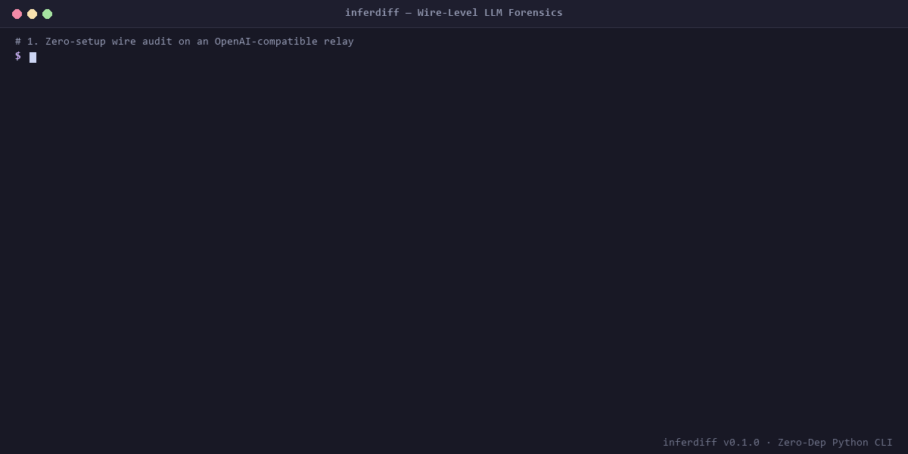

# inferdiff — 流式大模型接口的「协议验钞机」

[](https://github.com/ApacheWang/inferdiff/actions/workflows/ci.yml)
[](https://github.com/ApacheWang/inferdiff)
[](pyproject.toml)
[](LICENSE)

**HTTP 返回 `200 OK`，不代表你的流式推理真的没坏。**

`inferdiff` 是一款**零第三方运行时依赖**（纯 Python 3.10+ 标准库）的流式线协议体检与回归取证 CLI，原生支持 `llama-server`、`vLLM`、`SGLang`、`Ollama` 及各类 OpenAI 兼容网关与中转 API。

如果把压测工具比作“测水流快慢的水表”，把评测数据集比作“给作文打分的评委”，`inferdiff` 就是抓获底层静默损坏的 **Wireshark + 协议验钞机**。

[English Documentation (README.md)](README.md) · [PyPI (`inferdiff`)](https://pypi.org/project/inferdiff/) · [Releases](https://github.com/ApacheWang/inferdiff/releases)

`v0.1.0` 提供 OpenAI Chat 和 Responses 探针（`C1`–`C8`）、轨迹录制、离线差异检查和 HTML 瀑布图。`v0.1.1` 改进了思考模型与中转网关的检查，并加入 GitHub Action。`v0.2.0` 增加实时流式代理、Anthropic 和 Gemini 探针、KV 与存储探针、A/B 探针对比、持续监测，以及带 CI 报告的离线回放。详见[变更日志](CHANGELOG.md)。

下文的 v0.2 功能尚未发布。检出此分支后运行 `python -m pip install .`，即可安装开发版 `0.2.0.dev0`。



## 为什么需要 `inferdiff`？（专治四类监控全绿的“假正常”痛点）

| 受害角色 | `HTTP 200 OK` 掩盖下的真实线上故障 | 真实上游故障锚点 | `inferdiff` 如何当场抓获 |
| :--- | :--- | :--- | :--- |
| **Agent 与应用开发者** | 升级引擎或换量化模型后，函数调用 JSON 参数被预算截断一半却谎报 `completed` / `stop`；或思维链吃光预算导致正文全空却正常结束；或跨包切分吐出 `U+FFFD` 乱码，引发 Agent 反复重试。 | [`llama.cpp #30773`](https://github.com/ggml-org/llama.cpp/issues/30773)、[`Ollama #17274`](https://github.com/ollama/ollama/issues/17274)、[`vLLM #68324`](https://github.com/vllm-project/vllm/issues/68324) | `D1`、`D2` 与探针 `C1`、`C2`、`C6` 逐帧校验严格 JSON 语法树、多字节 UTF-8 边界与终态诚实性。 |
| **中转 API 与网关用户** | 不规范中转站或配错的 Nginx / LiteLLM 网关把非流式结果缓冲到最后倾泻成假流式脉冲、剥离空 `choices` 尾帧 `usage`、漏算工具 Schema Token、弄丢首帧 `role`、并行工具索引串台，或跨异构池路由。 | [`LiteLLM #5803`](https://github.com/BerriAI/litellm/issues/5803)、[`LiteLLM #16112`](https://github.com/BerriAI/litellm/issues/16112)、[`LiteLLM #24221`](https://github.com/BerriAI/litellm/issues/24221)、[vLLM Streaming Usage](https://docs.vllm.ai/en/latest/serving/online_serving/derenderer/) | `inferdiff doctor --profile relay` 发送轻量确定性探针（`C1–C8`），输出 `A+` 至 `F` 线协议健康评级。 |
| **AI Infra 与压测工程师** | 升级跑分看似“吞吐暴涨、TTFT 大降”，结果是定长 `ignore_eos` 请求提前短生成（如 `8 / 8000`）、前缀缓存未隔离污染基线，或靠提前发空握手帧刷低首帧延迟。 | [`SGLang #53119`](https://github.com/sgl-project/sglang/pull/53119)、[`SGLang #50443`](https://github.com/sgl-project/sglang/issues/50443)、[vLLM Benchmarking CLI](https://docs.vllm.ai/en/stable/benchmarking/cli/) | 严格剥离“空握手 `ttff_ms`”与“真首字 `ttft_effective_ms`”，自动拦截短生成与假加速（`D3`、`D5`）。 |
| **开源贡献者与发版 CI** | 流式输出每次切块位置不同，肉眼滚 `curl` 难以定位分叉帧；贴大段原始日志提 Issue 又常被维护者视为噪音直接关闭。 | [rusefi LLM Policy](https://github.com/rusefi/rusefi/wiki/LLM-policy) | 双层状态机抹平切块抖动，精准锁定**第一处分歧物理帧**，一键导出内网秒开的单文件 `<80 KiB` HTML 瀑布图与 `<=25` 行脱敏复现单。 |

## 5 秒零配置上手

已正式上线 [PyPI](https://pypi.org/project/inferdiff/)，可通过 [`uvx`](https://docs.astral.sh/uv/guides/tools/) 零安装运行，或使用 `pip` 本地安装（Python 3.10+，零第三方运行时依赖）：

```bash
# 1. 无需录制历史包，零安装一键体检本地推理引擎并生成单文件 HTML 瀑布图
uvx inferdiff doctor http://127.0.0.1:8080/v1 --html doctor.html

# 2. 专检第三方 OpenAI 兼容中转站（密钥自动脱敏），生成可截图分享的 HTML 评分卡
OPENAI_API_KEY="$RELAY_API_KEY" uvx inferdiff doctor https://api.your-relay.example/v1 \
  --model qwen3-32b --profile relay --html relay-report.html

# 3. 或通过 PyPI 安装一次
pip install inferdiff

# 无需 GPU，克隆仓库即可直接用内置 Case 1（llama.cpp #30773）体验 diff、HTML 瀑布图与 25 行工单导出
inferdiff diff \
  examples/case1_responses_truncated_tool/baseline.trace.jsonl \
  examples/case1_responses_truncated_tool/target.trace.jsonl \
  --html case1-waterfall.html

inferdiff export \
  examples/case1_responses_truncated_tool/baseline.trace.jsonl \
  examples/case1_responses_truncated_tool/target.trace.jsonl \
  --format github-issue
```

> **鉴权安全提示**：若未显式传入 `--api-key` 或 `-H "Authorization: ..."`，`inferdiff doctor` 会自动读取环境变量 `OPENAI_API_KEY` 发送至目标端点（生产密钥请务必使用 `https://`）。服务端反射回来的已知密钥会自动在终端、落盘轨迹、JSON 与 HTML 报告中脱敏。

## 抓取 SDK 的实时流量

```bash
inferdiff proxy --upstream https://api.openai.com --save-dir ./traces --only-breaches
```

将 OpenAI 兼容客户端的 Base URL 设为 `http://127.0.0.1:8787/v1`。使用 Claude Code 或 Gemini SDK 时，将 `--upstream` 改为对应服务商的 HTTPS 地址。如果客户端会自行拼接带版本号的 API 路径，Base URL 填 `http://127.0.0.1:8787` 即可。密钥照常配置在客户端。代理会转发鉴权信息，并对日志、抓包文件和状态输出脱敏。

代理收到流式数据后立即转发，在流结束时运行 `D1`–`D4`。访问 `http://127.0.0.1:8787/_inferdiff/status` 可查看 JSON 格式的计数和近期请求耗时。省略 `--only-breaches` 也会保存通过检查的流。用 `inferdiff audit` 可复查已保存的 `.trace.jsonl` 文件。

## 内网秒开的单文件 HTML 帧级瀑布图

所有 `diff --html`、`audit --html`、`doctor --html` 与 `export --format html` 均生成体积严格小于 `80 KiB`、零外链的单文件 HTML5 + 内联 SVG 报告：


> GitHub Markdown 会过滤页面内联交互脚本；前往 [`v0.1.0` Release 下载 `case1-waterfall.html` 附件](https://github.com/ApacheWang/inferdiff/releases/tag/v0.1.0)，即可离线悬停查看单帧耗时、切换绝对毫秒 / 归一化比例并点击任意帧检查详情。

## Anthropic 与 Gemini 流式探针

```bash
inferdiff doctor https://api.anthropic.com/v1 --model "$CLAUDE_MODEL" \
  --protocol anthropic --anthropic-version 2023-06-01 --json
inferdiff doctor https://generativelanguage.googleapis.com --model "$GEMINI_MODEL" \
  --protocol gemini --save-dir ./gemini-traces
```

- `C9` 检查 Anthropic `/v1/messages` 的事件顺序、`max_tokens` 终止原因和输出 Token 统计。默认读取 `ANTHROPIC_API_KEY`，通过 `x-api-key` 发送。
- `C10` 检查 Gemini SSE 的 `MAX_TOKENS` 终止原因、Token 统计和 UTF-8 完整性。默认读取 `GEMINI_API_KEY` 或 `GOOGLE_API_KEY`，通过 `x-goog-api-key` 发送。

## 对比、持续监测与离线回放

```bash
inferdiff compare \
  --a-url https://api.example.com/v1 --a-key '$KEY_A' --a-model model-id \
  --b-url https://relay.example.com/v1 --b-key '$KEY_B' --b-model model-id \
  --only C1,C4,C7 --out-json compare.json --out-md compare.md --out-html compare.html

inferdiff watch --base-url https://relay.example.com/v1 --model "$MODEL" \
  --profile relay --interval 60 --max-runs 10 --out-jsonl watch.jsonl \
  --fail-on-breach

inferdiff replay ./after --baseline ./before --out-json replay.json \
  --out-sarif replay.sarif --out-junit replay.xml --out-html replay.html
```

`compare` 并排展示两端的探针结果、终止原因和延迟。也可用 `--before-url`、`--after-url` 和 `--request` 向两端重放同一请求。

`watch` 定时执行体检，省略 `--max-runs` 时持续运行。用 `--webhook-url "$INFERDIFF_WEBHOOK"` 可通过通用 JSON、飞书或 Lark Webhook 接收故障和恢复通知。`--cooldown` 控制重复故障通知的间隔。

`replay` 可检查单个 `.trace.jsonl` 文件或整个目录。`--baseline` 按相对路径匹配轨迹，兼容 Windows 和 POSIX 路径分隔符，并区分新增、修复与未变化的问题。输入缺失、目录为空或轨迹格式有误时，退出码为 `1`。新增 P0 问题退出码为 `2`。使用 `--strict` 时，新增 P1 问题退出码为 `3`。

## 非侵入式 KV 与存储探针

`record` 和请求重放模式的 `compare` 可在发出请求前、首个有效 Token 到达时和流结束时采样。通过 `--probe-lmcache`、`--probe-mooncake-master`、`--probe-mooncake-client` 或 `--probe-pid` 读取 LMCache MP、Mooncake Store 或 Linux `/proc/<pid>/io` 指标。`D6` 检查页缓存预热，`D7` 检查查找命中后数据未交付，`D8` 检查碎片化物理读取或有存储指标佐证的首 Token 延迟回归。

## GitHub Action 集成（CI 门禁 + 自动上传 HTML 瀑布图）

在工作流中直接引用 `ApacheWang/inferdiff@v0.1.1`，即可对在线推理端点或离线双轨迹跑回归门禁并自动归档 `<80 KiB` 单文件 HTML 瀑布图：

```yaml
- name: Run inferdiff wire gate
  uses: ApacheWang/inferdiff@v0.1.1
  with:
    url: http://127.0.0.1:8080/v1
    profile: full
    strict: "true"
    html-out: inferdiff-report.html
```

v0.2 的 Action 在 `doctor` 和 `diff` 模式下均可通过 `sarif-output`、`junit-output` 写入 CI 报告。工作流检出 v0.2 源码后，可使用本地 Action。

```yaml
- name: Run inferdiff wire gate with CI reports
  uses: ./
  with:
    before-trace: traces/baseline.trace.jsonl
    after-trace: traces/target.trace.jsonl
    sarif-output: reports/inferdiff.sarif
    junit-output: reports/inferdiff.xml
```

使用默认的 `version: "0.1.1"` 并设置任一报告路径时，Action 会安装随源码提供的版本。若指定 PyPI 上的其他版本，请选择支持报告参数的版本。`upload-artifact` 上传 HTML 瀑布图，SARIF 和 JUnit 文件可由工作流另行上传。

命令行也支持报告导出。`doctor`、`audit`、`diff` 和 `replay` 可使用 `--out-sarif`（SARIF 2.1.0）和 `--out-junit`（JUnit XML），`compare` 支持 `--out-junit`。

## 健康评级与确定性 CI 退出码

- **Doctor 评级**：`A+`（全部探针通过、零跳过零告警）、`A`（无 P0/P1 问题，含 P2 建议告警或未触发/跳过项）、`B`（1 项 P1 告警）、`C`（2 项及以上 P1 告警）、`F`（检出 P0 静默协议违约或传输/HTTP 硬失败）。

| 退出码 | 枚举常量 | CI 语义 |
| :--- | :--- | :--- |
| `0` | `EXIT_OK` | 门禁通过（`doctor` 评为 `A+` / `A` / `B` / `C` 且未加 `--strict`） |
| `1` | `EXIT_USAGE_OR_IO_ERROR` | CLI 参数错误、轨迹格式损坏、目标不可达或非 200 HTTP 硬失败 |
| `2` | `EXIT_SILENT_PROTOCOL_BREACH` | 检出 P0 静默协议违约（`D1` / `D2` / `D4` 或 `doctor` P0 `FAIL`） |
| `3` | `EXIT_SEMANTIC_REGRESSION` | 检出 P1 回归或失真（`D3` / `D5`、终态漂移、TTFT 退化、`--fail-on any-diff` 或 `doctor --strict` P1 告警） |

## 离线安全与默认脱敏契约

- 单文件 `--html` 瀑布图内置零外链哈希锁定 CSP（`default-src 'none'; style-src 'unsafe-inline'; script-src 'sha256-...'; img-src data:;`），自适应帧折叠严格控制在 `80 KiB` 以内，断网跳板机直接双击秒开。
- 默认对外导出（`github-issue` / `json` / `html`）不回显任意 Prompt 正文与原始报文，如需附带原始帧请审阅后显式传入 `--include-body` 或 `--include-wire`。

## 生态定位：`inferdiff` 与现有开源工具的互补边界

`inferdiff` 刻意保持**“流式线协议手术刀”**的克制边界，不做大而全的模型智商排行榜或高并发压测平台，而是与社区成熟工具形成上下游互补：

| 相邻工具类别 | 优秀开源代表 | 什么时候应该用它们？ | 什么时候应该用 `inferdiff`？ |
| :--- | :--- | :--- | :--- |
| **语义评测与提示词回归** | [promptfoo](https://github.com/promptfoo/promptfoo) | 评估提示词改动或换模型后的最终回答准确率、RAG 忠实度与越狱安全性。 | 排查 SDK 拼装之前的**底层流式静默损坏**（`HTTP 200` 下的工具 JSON 半途截断、漏发闭合事件、跨包 `U+FFFD` 乱码）。 |
| **高并发吞吐压测** | [GuideLLM](https://github.com/vllm-project/guidellm)、[LLMPerf](https://github.com/ray-project/llmperf) | 测量高并发下的极限 QPS、TTFT/TPOT 分位数曲线与集群容量水位。 | 在压测前后**挤干跑分水分**（拦截 `ignore_eos` 下的 `8 / 8000` 定长早退、空握手帧刷低首字延迟、前缀缓存串扰与 v0.2 页缓存假高分）。 |
| **综合题库与渠道审计** | [ddalcu/llmprobe](https://github.com/ddalcu/llmprobe)、[lmspeed-audit](https://github.com/nexmoe/lmspeed-audit) | 在 Node.js 环境下用内置固定题库跑 API 覆盖率、GPQA/AIME 推理得分或渠道指纹筛查。 | 在只有 Python 的 GPU 算力容器或跳板机内，**零依赖录制并帧级 `diff` 你自己真实挂掉的生产请求**（平权支持 OpenAI Chat/Responses、SGLang 原生 `/generate` 与 Ollama NDJSON），并一键导出 25 行上游复现工单。 |
| **本地反向代理抓包面板** | [StreamLens](https://github.com/alexandrmotologa/streamlens)、[ForkMind](https://github.com/Medhovarsh/forkmind) | 在本地挂常驻反向代理拦截应用流量，在浏览器面板里交互式查看对话分支。 | 无需改架构挂代理，直接在命令行或 GitHub Actions CI 中跑**确定性回归门禁（退出码 `0/1/2/3`）**并导出小于 `80 KiB` 的内网离线单文件 HTML 帧瀑布图。 |

### 明确“不做什么”（Non-Goals）

- **不做裁判模型打分与智商题库**：不消耗大量 Token 测数学题或代码题；所有告警 100% 基于原始线协议字节、JSON 语法树与单调时钟时间戳确定性给出。
- **不引入重型运行时依赖**：核心 CLI 与 HTML/SVG 瀑布图渲染器永久保持 **Python 3.10+ 标准库零第三方强依赖**，不引入 Node.js、PyTorch 或任何外部 CDN 脚本。

## License

MIT
